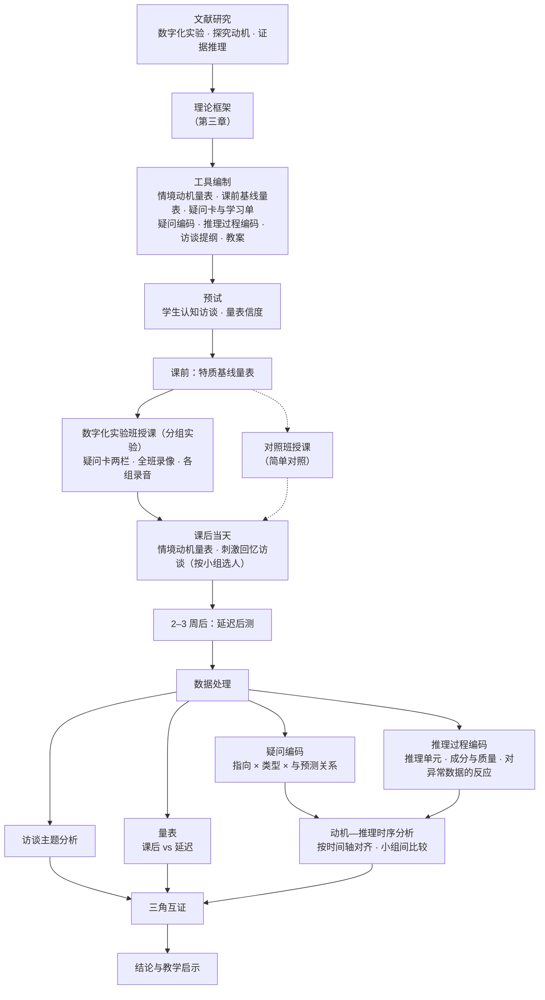

# 第一章 绪论（草稿）

> **2026-09-12 19:25 建。Clawd 起的草，不是晓艺写的。**
>
> **gap 那一段以她 09-11 11:54 的原话为准**（见 `thesis.md` 第一节）。
> **研究意义以老师给的那版为准**（`thesis.md` 第一节），**不用 Clawd 那版偏批判的**。
> ⚠️ **1.1 里的政策与推广现状需要她补数据和出处，我手上没有，已标出。**
>
> **2026-09-24 21:50 按老师 09-24 的修订改了结构**（原文和批注见 `advisor-0924.md`）：题目换成"探究动机与证据推理的互动生成过程"；1.1 只留"研究背景"，三级标题写观点，从政策往下收；原 1.1.2—1.1.4 合成两个观点，文献细节挪去 2.4.3；1.2 换成老师给的三个子问题；正文去掉页码。旧版在 git 历史里。

---

## 1.1 研究背景

### 1.1.1 数字化实验已进入中学化学课程与教学

数字化实验（又称手持技术实验）借助传感器与数据采集器，将实验过程中物理量的变化实时转化为数据与曲线。20 世纪末，手持技术在国内刚刚受到关注（黄碧芸、钱扬义，2011）。华南师范大学钱扬义团队自 1998 年开始手持技术实验研究，于 2003 年在国内率先撰文建议在中学化学教育领域应用（麦裕华、钱扬义，2020）；同年，中国知网中关于手持技术与化学整合的期刊论文首次出现，此后相关研究经历了 2003—2005 年的平稳起飞、2006—2008 年的快速前进与 2009—2010 年的高速发展三个阶段（黄碧芸、钱扬义，2011）。2009 年，钱扬义等提出曲线表征与"宏观—微观—符号—曲线"四重表征教学模式；截至 2018 年，该团队发表手持技术主题论文 68 篇、著作 3 部（麦裕华、钱扬义，2020）。

在课程层面，据麦裕华与钱扬义（2020）的梳理，《普通高中化学课程标准（2017 年版 2020 年修订）》有 3 处与数字化实验相关：课程内容的情境素材建议中列举了"压强对二氧化氮-四氧化二氮平衡影响的数字传感器实验"；教学与评价建议中要求"注重发挥现代信息技术的作用、积极探索现代信息技术与化学实验的深度融合、合理运用计算机模拟实验，但不能完全替代真实的化学实验"；教材编写建议中提出"适当增加微型实验、家庭小实验、数字化实验、定量实验和创新实践活动等"。同一部课程标准把"证据推理与模型认知"列为化学学科核心素养之一，要求学生"具有证据意识，能基于证据对物质组成、结构及其变化提出可能的假设，通过分析推理加以证实或证伪；建立观点、结论和证据之间的逻辑关系"。在政策层面，教育部办公厅 2025 年印发的《中小学科学教育工作指南》要求学校"构建科学实验室、探究实验室、综合实验室、数字实验室等"，"提高开放性、探究性实验比例，注重对学生问题提出、实验设计、动手操作、思维发展等能力的考查"，并"在做好实体类实验的同时，积极探索利用人工智能、虚拟现实等新技术开展实验教学"。可见，数字化实验的推进与学生问题提出能力的培养，在同一份国家文件的同一条要求中被一并提出。

然而，课程与政策层面的倡导并不等于课堂中的普及。上海市自 2007 年起向全市普通中学推广数字化实验系统，但 2012 年对该市两个区中学的抽样调查显示，学生使用数字化实验系统的学科中物理占 92.86%，化学仅占 2.71%；认为本校数字化实验设备已配置到位、符合课程标准要求的教师也只占 33.33%（薛耀锋等，2013）。十年之后，郑雁方等（2023）指出，数字化实验在许多一线城市已开始广泛使用，在普通城镇中学却尚未普及，马善恒等（2020）也指出手持技术数字化实验仪器"在经济欠发达地区普及率不高"。郑雁方等对湖北省某地级市 82 名高中化学教师的调查显示，仅 37.81% 的教师所在学校的实验设备能够满足数字化实验教学，在课堂上使用数字化实验频率较高的教师仅占 23.17%。即便在已配备设备的学校，常态化使用的比例同样不高：对东北三省 10 所已配备手持技术实验设备的高中 148 名化学教师的调查中，经常使用的教师占 24%，69% 的教师只是偶尔使用（刘忠慧，2020）。对来自 19 个省份的 60 名化学教师的态度调查则显示，不同类别的教师一致认同"实验资源与支持"是影响手持技术实验应用的最重要因素，也是"制约手持技术实验应用的主要矛盾"（朱庆等，2019）。

可见，数字化实验已有明确的课程与政策依据，却尚未在课堂中常态化使用。在有限的使用机会中，数字化实验究竟为学生的探究带来了什么，成为需要回答的问题。

> ✏️ **上面四段是 09-14 上午照下面的材料写的正文**（送审初稿用）。只用了已核过的材料；指南那两句是网页工具抽的，定稿前对原网页核字。

**以下是写作材料，定稿后删。**

⚠️ **本小节要三类材料。第 1、3 类 09-13 已齐，只剩第 2 类（推广现状数字）。不替她编：**

1. **课程标准的原文依据**——⭐ **线索已经有了**：麦裕华、钱扬义（2020）指出
   《普通高中化学课程标准（2017 年版）》**共 3 处提出对手持技术实验的要求**，并引了原文与页码：
   - **课程内容**（选择性必修·模块 1 化学反应原理·主题 2）情境素材建议：
     "化学平衡影响因素的证据素材，如压强对二氧化氮—四氧化二氮平衡影响的数字传感器实验"（第 32 页）
   - **实施建议·教学与评价建议**："注重发挥现代信息技术的作用，积极探索现代信息技术与化学实验的深度融合"（第 73 页）
   - **教材编写建议**："化学教材应精心设计学生必做实验，适当增加微型实验、家庭小实验、**数字化实验**、
     定量实验和创新实践活动等"（第 82 页）

   ✅ **09-13 晚用她电脑上的 `D:\师范\课标\《普通高中化学课程标准（2017年版）》（WORD版）.docx` 核过原字，三条都在：**
   - 第一条：四、课程内容 · 选择性必修 · 主题 2 化学反应的方向、限度和速率 · 【教学提示】3. 情境素材建议。原文是"二氧化氮-四氧化二氮"，后面接"，酸碱指示剂的变色。"
   - 第二条：六、实施建议 · （一）教学与评价建议 · 3. 充分认识化学实验的独特价值，精心设计实验探究活动 · （1）。
     **标点是顿号**，而且句子没完：原文是"注重发挥现代信息技术的作用、积极探索现代信息技术与化学实验的深度融合、合理运用计算机模拟实验，**但不能完全替代真实的化学实验**"。引的时候后半句别掐掉，掐了意思会偏。
   - 第三条：六、实施建议 · （三）教材编写建议 · 2. 化学教材内容的选择 · （2）重视实验探究与实践活动。✅ 一字不差。
   ✅ **页码 09-13 21:52 她翻纸质本核了：第一条第 32 页，第二条第 73 页，第三条第 82 页**，跟麦裕华给的一致。
   ✅ 纸质本封面是 **"2017 年版 2020 年修订"**（她 09-13 说，电子版和纸质本都是老师发的）。参考文献按这个写。
   ⭐ 顺带一条可用于"推广现状"的课标依据：六、实施建议 · （四）地方和学校实施本课程的建议 · 3. 加强化学实验室和化学学科专用教室建设——"有条件的地方和学校应逐步引进一些现代化仪器设备，并向学生或学生课外兴趣小组开放，在教师或实验员指导下开展实验探究活动。"
   ⭐ **版本问题有答案了**：赵丽娜、高洪权（2026）引用时写的是
   **《普通高中化学课程标准（2017 年版 2020 年修订）》**——即现行版本应写作这个全称。
2. **数字化实验在中学的推广现状**——教育部或地方的装备配备文件、或已有综述中的统计数字，**要有出处**。
   ✅ **09-14 21:00 补上了**：她用知网的 AI 查到、再一篇篇点进去下载了 36 篇，放进 `D:\师范\毕设\检索结果\`（20:44–20:57 下的）。我读法：标题带"现状/调查"的 4 篇字体坏了，200dpi OCR 从头读（郑雁方 7 页、陈晨新 3 页、陈泓百 5 页、马善恒只有 1 页）；其余 32 篇抽文字层搜"配备/普及/%/教师"关键词，**没通读**。写进正文第 19 行的两条：
   - **郑雁方, 任霜蛟, 刘晶晶, 周鑫, 杨水金. 数字化实验在中学化学教学中的应用现状调查及对策研究. 湖北师范大学学报（自然科学版）, 2023, 43(1): 85-91**。DOI 10.3969/j.issn.2096-3149.2023.01.013。湖北某地级市普通高中/市重点/省重点的高中化学教师，问卷星，82 份全有效，α=0.733、KMO=0.767。
     - 第 87 页正文原话："只有37.81%的教师所在的学校的化学实验设备能够满足数字化实验的教学，62.19%的教师所在学校是满足不了数字化实验的教学"；"在课堂上开展数字化实验频率较高的老师只占23.17%，45.12%的教师开展的频率并不高"（表 2：非常高 17.07 + 一般高 6.10 = 23.17，对得上）
     - 摘要："目前数字化实验在许多一线城市已经开始广泛的使用，但在普通城镇中学却并没有进行普及"
     - 第 86 页还有：操作较熟悉的教师仅 20.73%；非常了解的 3.66%、不了解的 18.29%
     - ✅ **09-14 21:26 她对着 PDF 看过了，是对的**。样本是一个地级市，**别写成全国**
   - **刘忠慧，《基于手持技术的高中化学实验教学研究》，牡丹江师范学院教育硕士学位论文**，2020（答辩日期 2020-06-02，09-14 她查的）。第三章调查：东北三省（黑、辽、吉）**已配备手持技术实验的十所高中**化学教师，2019-12-15 至 20 问卷星，148 人。原话："仅 24%的教师经常使用手持技术实验进行化学教学……有 69%的教师偶尔使用……有 7%教师不使用手持技术，大多数为高三学年教师"；另"仅有 19%的人参加过手持技术相关培训"。**有文字层，不是 OCR**。⚠️ 师范院校硕士论文，老师要是嫌分量轻，就换成下面薛耀锋那篇
   - ✅ **09-14 21:21 她下了，21:40 我从头读完（6 页，有文字层）：薛耀锋、祝智庭、陈汉军、陆李杨、王美. 上海市中学数字化实验教学现状抽样调查与分析. 中国电化教育, 2013(1): 88-93**。CSSCI。上海 Q、F 两区，2012 年 3—4 月，学生 812 份、教师 54 份。进了正文第 19 行：
     - 第 88 页："2002年在全市部分中学开展数字化实验的试点教学活动，2007年开始向全市所有普通中学推广使用数字化实验系统"
     - 第 89 页：学生使用数字化实验系统的学科"物理学科占92.86%，化学学科占2.71%"
     - 第 91 页：设备"33.33%的教师认为已配置到位，符合要求；51.85%的教师认为已部分配置，还有些实验不能做；5.56%……不理想；9.26%……比较糟糕"
     - ⚠️ **样本偏物理**：学生卷问的是"物理实验""物理基础教材"，教师卷里"物理学科占100%，其他学科（如化学、生物）还没有开展相关实验课程"（第 91 页）。所以 2.71% 不能写成"上海化学只有 2.71% 在用"，正文只写"学生使用的学科中"。**老师要是追问，照实说样本以物理为主**
     - ⭐⭐ **跟设备类拆分直接相关的一条**（第 90 页）："有42.12%的学生表示对数字化实验的实验器材、实验现象和实验过程三个要素都感兴趣，另有13.18%的学生关注实验器材，23.03%对实验现象感兴趣，21.67%重视实验过程"。→ 学生的兴趣确实会单独落在器材上，已补进 3.2.4 其五当旁证
     - 其他：只有 42.12% 的学生完成了教材上每个学生实验（第 90 页）；教师熟悉度超过 80% 的只有 27.78%，31.48% 没参加过培训（第 91、93 页）
   - ✅ **09-14 21:38 她下了，21:50 我 OCR 从头读完（6 页，字体坏的）：朱庆、钱扬义、麦裕华、杜慧鸣、石光. 化学教师对手持技术数字化实验应用的态度调查. 化学教学, 2019(10): 13-18**。"国培计划（2018）"华南师大化学班 60 名学员，19 个省份，高校 21 / 教研机构与进修学校 12 / 中学 27。自编问卷，题组 2 α=0.963。**是态度调查，没有配备率、使用率数字**。
     - 进了正文第 19 行：第 17 页"'实验资源与支持'是人们认为影响手持技术实验应用的最重要因素，也是制约手持技术实验应用的主要矛盾"；摘要"不同类别教师均认同'实验资源与支持'是最影响手持技术实验应用的因素"
     - ✅ **09-14 22:20 进了 2.4.3 其五末尾**（她说可以）。第 15 页原话（130dpi 渲染看原页核的）："中学教师更认同'教学实践'维度'帮助学生理解化学概念，提高课堂教学效率'功能……高校教师主要认同'教学实践'维度'激发学生化学学习兴趣，培养内在学习动机'功能"。三类教师都首选"实验操作"维度（定量、实时、直观）
     - 表 3（题组 1 均分）看原页是清楚的，不是 OCR 那版乱的：第 5 项"激发兴趣、内在动机"高校 0.43 / 中学 0.26；第 6 项"理解概念、提高效率"中学 0.41。**均分怎么算的在前两页，没看，所以正文不引数字**
     - ⭐ 没进正文、跟曲线那条线有关：第 4 项"**反映化学反应的整体趋势与局部细节**"高校 0.10 / 教育支撑机构 0.27 / 中学 0.22，在"实验操作"四项里偏低。→ 教师眼里曲线的"过程"价值不突出。**要用得先看均分算法**
     - 参考文献里还有一篇更早的：邓峰、钱扬义、陈徽等. 化学教师对手持技术在教学中应用所持态度的调查研究. 化学教育, 2008, 29(4): 50-52, 60（转引，没见原文；**跟第二章里的邓峰等 2008 是不是同一篇，没核**）
   - **马善恒、王后雄、刘正宇. 中学化学手持技术数字化实验研究的演进及展望. 化学教育（中英文）, 2020, 41(17)**，第 112 页起。~~只有第 1 页、句子断在页尾~~ ❌ **我看错了**：是左右分栏，OCR 把两栏读串了（09-14 21:40 她指出来的，原文她贴给我了）。原话："手持技术数字化实验仪器在经济欠发达地区普及率不高，这直接导致了这些地区在此方面研究及应用相对滞后，故应加大数字化实验仪器的资本投入"。**没有数字**。✅ **09-14 22:20 进了 1.1.1**，接在郑雁方"普通城镇尚未普及"后面（她说可以）。22:18 看原页核过，是第 112 页（全文只有这一页）
     - ✅ **同页还有一句，09-14 22:22 她说可以，进了 2.4.3 其三当第四次标示**（小结同步改成"四次"）：二（2）"目前国内数字化实验研究的主流还是案例研究，缺少在科学教育中应用数字化实验后对学生的认知情况和学习能力所产生影响的研究。教学的主体是学生，而恰恰缺乏学生运用数字化实验学习时的心理机制的研究[3]"；一（3）"实验案例研究及理论研究较多，而手持技术数字化实验对于学生发展影响的实证研究偏少"。→ 可以当 2.4.3 其三的第四次标示（2005 / 2011 / 2019 / 2020）。**注意它说的是"心理机制"，不专指动机**，跟黄碧芸 2011 同一类说法；[3] 是王晶、郑长龙、徐洁等，化学教育 2011, 32(3): 16-18, 23，没见原文
   - 陈晨新等 2013（中国教育技术装备 2013(6)）只有定性描述（"并不是每所学校都有能力装备数字化实验室""已经装备……将其闲置一边"，第 125 页），没数字，没用上
   - 陈泓百 2025（物理教学探讨）是综述，一句可用的判断："政策大力推动、价值广泛认可，但实施效果未达预期"（第 13 页，OCR 读的），**物理学科的**，没用上
   09-13 晚找过一轮，**还没有能直接引的数字**：
   - 已下的文献里（有文字层的）搜"配备率 / 普及率 / 已配备"，**没有现成统计**；字体乱码的那批搜不到，不排除里面有
   - 网上线索（**都没核，不能直接引**）：
     - ✅ **09-14 早上心跳时看了**：**教育部办公厅关于印发《中小学科学教育工作指南》的通知，教监管厅〔2025〕1 号，2025 年 1 月 14 日**。https://www.gov.cn/zhengce/zhengceku/202501/content_7000414.htm
       - 二、主要工作 ·（二）学校 · 5. 紧扣探究实践强化实验教学："构建科学实验室、探究实验室、综合实验室、**数字实验室**等""完善设施设备和耗材供给""在做好实体类实验的同时，积极探索利用人工智能、虚拟现实等新技术开展实验教学"
         - ✅✅ **09-14 14:58 对着 gov.cn 原网页逐字核过**，正文第 17 行那两句引文一字不差（第一句原文还有前半"根据实验室建设与教学装备配置标准，"，引的是后半，没问题）。成文日期 2025 年 01 月 14 日，发文机关教育部办公厅
         - ⭐ **同一条的第（2）点核的时候顺手看见的**："提高开放性、探究性实验比例，注重对学生**问题提出**、实验设计、动手操作、思维发展等能力的考查"。**国家文件里点名了"问题提出"**。✅ **09-14 19:23 她说"写一下"**，19:27 又对 gov.cn 原网页核了一遍，一字不差（在"5. 紧扣探究实践强化实验教学"的第（2）点，前后正好夹在"数字实验室"那句和"新技术"那句中间）。已写进正文第 17 行，按原文顺序排；末尾加了一句"同一条要求中被一并提出"是我的归纳
       - 二、主要工作 ·（一）教育行政部门 · 8. 数字化赋能科学教育："利用智能装备为科学教学创设沉浸式学习环境"
       - 文中还提到依据《中小学实验教学基本目录（2023 年版）》——✅ 09-14 07:14 心跳时读了（教育部基础教育司委托中央电化教育馆研制，[教育部发布新闻](http://www.moe.gov.cn/jyb_xwfb/gzdt_gzdt/s5987/202311/t20231123_1091833.html)，[目录 PDF](http://www.ncet.edu.cn/u/cms/www/202311/241430136xjv.pdf)）：
         - **普通高中化学部分没有专门列"数字化实验"或"传感器"**，只有选择性必修主题 1 的"42. 利用计算机作图分析元素性质相关参数的变化规律"。**所以别写"目录要求数字化实验"**
         - 但**必修主题 2「电离与离子反应」列了"6. 探究电解质的电离""7. 探究溶液中离子反应的实质及发生条件"**，选择性必修 1 主题 3 列了"36. 探究电离平衡及其移动""37. 强酸与强碱的中和滴定"——**载体要是定离子反应，这是国家目录层面的依据**（第 66—67 页附近，页码按 PDF 版面，定稿核）
       - ⚠️ 上面引文是网页工具抽出来的，**定稿前打开原网页对一遍字**
       - **能怎么用**：1.1.1 写"国家层面已要求学校建设数字实验室、探索新技术开展实验教学"，这是政策依据，**但不是配备率数字**
     - 《中学化学数字化实验的新趋势》（华东师大《化学教学》）：https://chemedu.ecnu.edu.cn/CN/abstract/abstract2608.shtml
     - 有博客提到陕西某地 2012 年起投资数字化实验室、覆盖一百多所高中，**来源是博客，不引**
     - 2019 年前后教育部有一份关于加强和改进中小学实验教学的文件，**我记得有、没查到原文，文号不写**
   - **知网上她可以搜**："数字化实验 配备 现状 调查"、"中学 数字化实验室 建设 现状"，或翻《中国现代教育装备》《实验教学与仪器》这类装备期刊
   - 09-14 19:40 我给的专业检索式她搜出 0 篇；19:43 改给她高级检索界面的搜法（主题"数字化实验"并且"现状"／"手持技术"并且"调查"／单搜"数字化实验室"，不勾筛选，看学位论文标签）。**她在找，找到的 PDF 我来读**
   - 找不到全国数字也没关系：写成"已被写入课程标准（3 处）+ 研究文献 2003 年起持续增长（黄碧芸、钱扬义，2011）+ 各地建设水平不一"，同样立得住
3. ✅ **手持技术 / 数字化实验在国内的引入时间线**（09-13 晚从已读文献理出来的，都有出处）：
   - 20 世纪末，手持技术在国内"刚刚受到关注"（黄碧芸、钱扬义，2011，第 95 页）
   - 1998 年，钱扬义团队开始手持技术实验研究；2003 年在国内率先撰文建议在中学化学教育领域应用（麦裕华、钱扬义，2020）
   - 2003 年，知网中关于手持技术与化学整合的期刊论文首次出现；2003—2004 年多借"掌上实验室"体现其价值（黄碧芸、钱扬义，2011，第 95、98 页）
     - 第一篇期刊论文：钱扬义《在掌上实验室探究酒精灯火焰温度——得出不同的结论》，《化学教育》2003 年第 1 期；第一篇学位论文：华东师大李淑妍 2006 年硕士论文《基于传感器技术的中学化学实验开发及教学应用研究》（同上，第 99 页，**原文我没下，是黄碧芸说的**）
     - 截至 2010 年常用传感器是 pH、温度、色度计、电导率，离子传感器"没有一个手持技术案例"（同上，第 99—100 页）
     - 2011 年时已有的教学模式："四重表征"教学模式、"10C"（课题探究模式）、"6S"（实验探究模式）（同上，第 100 页）
   - 2003—2005 平稳起飞、2006—2008 快速前进、2009—2010 高速发展，2003—2010 共 83 篇；心理探析类 2006 年才出现（同上，第 95—97 页）
   - 2009 年，钱扬义提出曲线表征与"宏观—微观—符号—曲线"四重表征教学模式（见 2.3.1）
   - 截至 2018 年，该团队发表手持技术主题论文 68 篇、著作 3 部（麦裕华、钱扬义，2020）
   - 2017 年版课标（2020 年修订）共 3 处涉及：数字传感器实验（第 32 页）、现代信息技术与化学实验的深度融合（第 73 页）、数字化实验（第 82 页）。**第 73 页那句原文没出现"数字化实验"四个字，别写成"3 处要求数字化实验"**
   **写法**：1.1.1 里压成一段话即可，细节留给 2.1.1，别两处重复展开。

**这三类补齐后，本小节的写作逻辑是：**数字化实验已在中学具备一定的装备基础，
且课程标准对科学探究提出了明确要求；在此背景下，"数字化实验是否有助于探究式教学"
成为一个被广泛研究的问题。

### 1.1.2 数字化实验对学生动机的影响，整体层面的结论并不一致

围绕数字化实验与学生动机的关系，已有研究多在整体水平上报告效果，结论却有正有负。一方面，有研究报告实验组学生的学习体验和参与度显著提高（谢金凤，2025），也有教学反思转述学生认为实验曲线能激发自己思考其产生原因的冲动（朱成东，2023）；另一方面，微机实验组学生在概念联结中出现了更多错误联结（Nakhleh & Krajcik，1994），学生在设备操作上需要额外支持（Meulenbroeks 等，2024），若实验缺乏探究性，学生的注意力可能更多聚焦在仪器上而忽视实验过程（杨赵丹，2022）。兴趣研究早已指出，计算机等新异刺激能够触发情境兴趣，却未必能使兴趣得以维持（Hidi & Renninger，2006）。

由此看来，"数字化实验能否提升动机"难以给出统一的回答。更值得追问的是：数字化实验所激发的是何种类型、何种质量的动机，它是短暂的情境兴趣，还是能够在探究中延续下去的投入。

### 1.1.3 探究动机与证据推理相互推动，其互动过程尚缺少考察

在化学探究中，动机并不孤立存在。学生因为想弄清原因而去寻找和分析证据，证据的反馈又会使这份想弄清的愿望增强或减弱。课程标准所要求的证据推理，正是在这样的来回中展开的。数字化实验恰好作用在证据这一端：传感器把变化的过程实时转化为曲线，改变了证据的形态，也缩短了从操作到看见结果的反馈周期。它因此可能在动机与推理之间起中介作用，并对探究中遇到不同困难的学生提供不同的帮助。

然而，国内同行已多次指出，学生运用数字化实验学习时的心理机制缺乏研究（黄碧芸、钱扬义，2011；马善恒等，2020），"如何将学生对实验的兴趣变成持续的动机"仍有待深入研究（吴晗清等，2019）。就本研究检索所及，尚未见到在数字化实验情境中，追踪学生探究动机与证据推理如何先后发生、相互推动的研究（详见 2.4.3）。

---

## 1.2 研究问题

本研究的问题经过了逐步收窄。已有研究多比较数字化实验与传统实验在动机整体水平上的高低，结论不一；本研究不再追问动机"是否提升"，而转向动机的类型与质量结构；又因探究动机总是在寻找、分析证据的过程中起落，本研究进一步把关注点放在动机与证据推理的互动过程上，并考察数字化实验在其中所起的中介作用。

**主问题：**在数字化实验中，学生的探究动机与证据推理如何互动生成，数字化实验在其中起何种作用？

**三个子问题：**

1. 数字化实验中，学生的探究动机如何被激活、维持？其结构类型呈现什么特征？
2. 数字化实验中，学生探究动机的变化如何与推理进展发生联系？即探究动机的结构类型及其变化，与证据选择、数据质量评价、化学解释及结论修正等推理过程之间有何联系。
3. 哪些教师、同伴或任务条件支持或阻碍上述过程？

> ⚠️ **主问题她要定。**老师在修订里写的主问题是"数字化实验和传统实验在学生化学学习动机结构上产生了何种差异？"，可她同一份里又写"两种班级的效果对比不是本研究的重点，中间过程机制才是重点"，题目也改成了"互动生成过程"。上面那句是我按新题目写的，跟她写的三个子问题对得上。**要是想稳，就用老师原话，下次见老师顺口问一句。**
>
> ⚠️ **子问题 2 的推理过程要有文献撑**（老师原话："这里推理过程需要有文献支撑，不是研究者个人凭大脑思考给出推理过程"）。"证据选择、数据质量评价、化学解释、结论修正"这四步是老师给的。**09-24 22:08 出处找到了、读了**：Chinn & Brewer（1993）管数据质量评价和结论修正，EBR 框架（Brown 等，2010；Furtak 等）管证据选择和化学解释，对照表在 `evidence-reasoning.md` 第零节。正文写进第二章综述和第三章理论框架，第一章不展开。

---

## 1.3 研究意义

**理论意义。**已有研究多在整体水平上考察数字化实验对动机的影响。本研究把考察的重心移到过程上，刻画探究动机与证据推理在探究活动中如何先后发生、相互推动，并揭示数字化实验在其间的中介作用，为学习动机研究与化学证据推理研究提供一处交汇点。

**实践意义。**本研究深入考察学生在数字化实验课堂中的心理转变，既关注数字化实验对动机与推理的支持，也关注设备操作等可能带来的干扰，使一线教师能够了解学生在这类课堂上的心理状态与需求，从而辅助备课；对支持与阻碍条件的梳理，可为教师在数字化实验中有效激发并维持学生的探究动机、支持学生的推理过程提供依据。

> ✏️ 09-24 按老师的方向重写。老师给的研究意义原版（"深挖学生在数字化学习过程中的心理转变，可能有好处也有坏处……辅助备课"）还在实践意义里，没丢。批 148 说"这一落点对研究设计提出了两项具体要求"那种解释性文字不进论文，原来那段挪到下面当自己看的材料：
>
> - 干扰一侧的线索：设备操作要支持（Meulenbroeks 等，2024），操作不熟练的学生注意力集中在操作上（李法瑞，2009），设备操作类疑问的占比当指标 → 放第三、四章
> - 访谈不只问"你被什么吸引"，也问"哪里让你卡住、想放弃" → 访谈提纲
> - 教师当堂可用的观察指标："学生的问题指向曲线 → 被真正钩住了；只说'这个图好酷' → 是新鲜感" → 第六章教学启示

---

## 1.4 研究方法与思路

本研究以质性研究为主、量化数据为辅（详见第四章）。研究者在实习学校独立授课，在数字化实验班开展深入的质性研究并实施前后测；若一个班的数据不足，在第二个班再上一次。另设一个不使用数字化实验的对照班，同样实施前后测与访谈，其结果作为简单对照【班级安排待实习学校确定】。

数据来源包括：学习单（含课前预测）与探究疑问卡、分组实验的课堂录像、课前施测的特质基线量表、课后当天与延迟后测的情境动机量表，以及课后刺激回忆访谈。访谈对象从表现不同的小组中选取，提纲在原有基础上增加指向证据推理与化学问题解决的问题。

分析方法包括：对学生疑问作问题类型与疑问指向的交叉编码，结合课堂录像按时间顺序还原各小组动机表现与推理步骤的先后关系；比较不同小组的探究过程，分析表现差异的来源；结合访谈与量表数据，对动机与证据推理的互动过程作出有过程证据的解释。研究的技术路线见图 1-1。

> ✏️ 09-24 按老师在 4.2.1 写的设计改的（一个人上课、数字化实验班深挖、对照班简单对照、比小组、访谈往推理上引）。
>
> ✏️ 图 1-1 09-24 22:25 按新设计重画了（`figures/fig1-1.png`，源在 `figures/_render.html`）。
>
> ⚠️ **老师问的一句只能她去看**："数字化实验设备能否做到有几组学生亲自动手做"——学校传感器有几套。

**图 1-1 技术路线（草图 v2，09-24）**

⚠️ 跟 3.4 的理论框架图区分开：**这张是做事的先后，那张是机制**。

---

## ⚠️ 这一章还要做的

1. ✅ **09-14 21:00 推广现状数字补了**（郑雁方 2023、刘忠慧 2020，见材料第 2 类；她都核过了）。原来写的：**1.1.1 只剩推广现状数字**（课标原文、引入时间线 09-13 齐了；政策文件 09-14 读了两份，定稿前对原网页核字）。**要有出处。**
2. ✅ 谢泽琛 2007、谢金凤两条引用的页码 09-13 晚核过，已补进 1.1.3。
3. **1.4 等设计定稿**，尤其班级数那条要先跟指导老师谈。
4. ~~技术路线图待绘~~ 草图 v1 已画（1.4），定稿重画成插图。**09-24 设计改了，要重画。**
5. **09-24 老师要的：推理过程要有文献支撑。**子问题 2 那四步（证据选择、数据质量评价、化学解释、结论修正）要找一个现成框架挂上。候选，**都没读原文，先下载再说**：
   - 课标"证据推理与模型认知"素养 3 及学业质量水平（原文在手边，已引进 1.1.1）
   - McNeill & Krajcik 的"主张—证据—推理"（CER）框架
   - Chinn & Brewer（1993）学生对异常数据的七种反应（正好对上"结论修正"，也对上她原来"与预测不符"那条）
   - Brown 等（2010）的基于证据推理框架（Evidence-Based Reasoning）
   - 国内"证据推理"化学教学研究（知网搜"证据推理 化学 实验 探究"），黄毓展那篇离子反应 + 数字化的课例已经在 `检索结果` 里
6. **09-24 批 99、150：大段引文和页码。**全文去掉正文里的页码（第一章已去）；二章 2.1 那段 36 个案例（钱扬义团队综述）要标出处并改写成自己的话，别整段照搬，查重会高。
