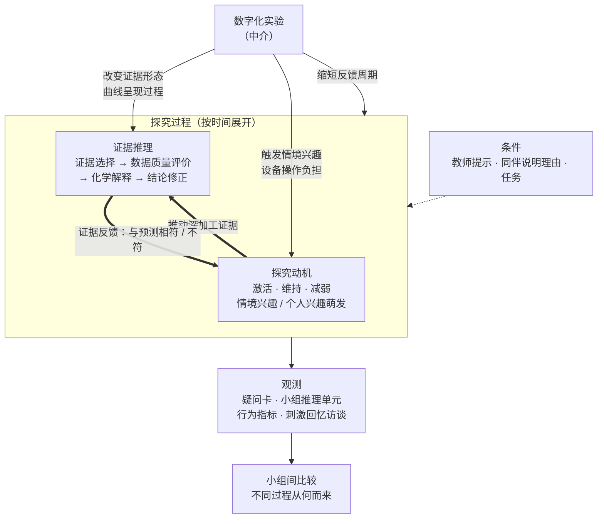

# 第三章 理论基础与理论框架（草稿）

> **2026-09-12 17:40 建。3.1 是我（Clawd）起的草，不是晓艺写的。**
>
> 起草依据：`thesis.md` 第六节（理论基础 → 构念转化 + 情境转化 → 理论框架）
> 和第五节，`four-representations.md`，`measurement-plan.md`。
>
> **3.1 全部是原样陈述别人已经建好的东西，没有一句是本研究的原创**，
> 所以这一节可以整段推翻重写，不心疼。
> **3.2.4 的三条边界是晓艺拍板的，正文 v1 是我照她的决定写的，等老师看。**
>
> ⚠️ 本节引文的年份和出处见文末「待核对」，**动笔定稿前必须自己核一遍原文**。

---

## 3.1 理论基础

本研究的理论基础由四部分构成：Johnstone 的三重表征理论，用以刻画化学知识被表征的形式结构；Deci 与 Ryan 的自我决定理论，用以解释学习动机发生与维持的心理机制；Hidi 与 Renninger 的兴趣发展四阶段模型，用以刻画兴趣由情境性向个人性转化的过程；证据推理的相关理论，用以刻画学生在探究中如何处理证据。四者分别回答四个问题：化学知识以何种形式呈现给学生，学生为什么想学，这种"想学"能否持续，以及学生怎样由证据得出结论。

本节陈述四种理论的原始主张；将其转化为本研究可测量的构念、并落实到数字化化学实验课堂情境的工作见 3.2 与 3.3，据此组装的理论框架见 3.4。

### 3.1.1 Johnstone 的三重表征理论

三重表征理论由苏格兰化学教育研究者 A. H. Johnstone 提出。他在 1982 年即提出"多层次思维"的概念，1991 年在《为什么科学难学？事情往往并非表面所见》一文中，以一个三角形概括了科学思维的三种层次，并将其作为解释科学学习困难的核心机制之一。就化学而言，这三个层次是：可被直接感知的宏观现象；以原子、分子、离子等不可见微粒对现象所作的解释；以及化学式、化学方程式等符号系统对前两者所作的形式化表达。Johnstone 指出，相同结构的三角形存在于所有科学学科之中——物理学为宏观、不可见（力、电子等）与符号（数学与公式），生物学为宏观（动植物个体）、微观（细胞）与生物化学（DNA 等）。

Johnstone 提出这一三角形，其本意并非主张"好的化学教学应当同时呈现三重表征"，而恰恰相反。他的论证是：教师往往在一句话之内就跨越整个三角形，而学生可能仍滞留在宏观一角；课堂教学大量发生在三角形内部，三个层次以不同比例交互，教师却未必意识到这对学生构成了何种负担。他明确反驳了"只有在三个层次间往返才算真正的化学"这一说法，称其为无稽之谈，并指出仅在宏观层次上同样可以做出完全正当的化学。他进而提出，科学在某种意义上应当只在宏观层次讲授，而将解释性层次作为可按需索取、且分量足够小的附加内容提供。

这一立场的理论依据是工作记忆的容量限制。Johnstone 借助信息加工模型说明，多层次思维会迅速使工作记忆空间超载——观察、解释与同时进行的符号表征三者一并占用有限的加工空间，而教师之所以能在层次间快速跳转并将其融为单一的"实在"，依靠的是长期训练形成的组块能力，学生并不具备。

Johnstone 在同一文中对实验教学提出了两点判断，对本研究尤其重要。其一，他指出实验中的观察同时包含"信号"与"噪声"，而学生无法区分二者：一个偶然产生的气泡会与颜色变化、温度变化获得同等的重要性，关键的信号常常因学生被噪声吸引而被错过。其二，他指出书面的实验指令虽然倾向于把注意力聚焦到信号上，但同时阅读指令、操作仪器与进行观察会造成工作记忆的严重超载，以致解释、观念重组与有意义学习无从发生。

本研究实际使用的分析工具是"四重表征"。第四重并非 Johnstone 的原始主张。Nakhleh 与 Krajcik 于 1994 年主张化学中存在四个相互联系的表征系统，即宏观系统、微观系统、符号系统与代数系统，其中代数系统指借助公式与图像对物质间关系所作的呈现与操作；钱扬义于 2009 年首次提出"曲线表征"的定量分析方法，并构建了"宏观—微观—符号—曲线"的四重表征教学模式。需要辨明的是，前者虽在数目上已为四重，但其代数系统在该研究中被具体操作化为各类计算，而曲线（如滴定过程的 pH 曲线）被归入符号系统，作为一种符号化记录处理；将曲线自符号系统中独立出来、作为单独一重并给出相应分析方法的，是后者。本研究采用的正是后一版本。相关谱系与概念辨析见 2.3，第四重为何应定为曲线而非代数见 3.2.1。

### 3.1.2 自我决定理论

自我决定理论（Self-Determination Theory，SDT）由 Deci 与 Ryan 自二十世纪七十年代起逐步发展，并于 1985 年系统提出，是一个关于人类动机的宏观理论。

该理论首先区分内在动机与外在动机。内在动机指个体从事某项活动的原因即在活动本身——出于兴趣、好奇或从活动中获得的享受；外在动机则指个体为了活动之外的结果而从事该活动。此后，该理论进一步提出外在动机内化的连续谱，依自主程度由低到高依次为外部调节、内摄调节、认同调节与整合调节。这一发展意味着，内在与外在并非简单的二分，而是自主程度上的连续变化，判断一种动机的性质，关键在于个体在多大程度上认同并自愿地从事该活动。

该理论的核心是三种基本心理需要，即自主感、胜任感与归属感。自主感指个体体验到行为出于自身选择而非受人驱使；胜任感指个体体验到自己有能力有效地应对所面对的任务；归属感指个体体验到与他人之间的联结与接纳。自我决定理论的基本命题是：当外部情境支持这三种需要时，内在动机得以维持乃至增强；当外部情境挫败这三种需要时，内在动机被削弱。作为其子理论的认知评价理论进一步处理奖励、反馈、选择权等具体外部事件如何经由改变自主感与胜任感而影响内在动机。

在测量上，自我决定理论有配套工具内在动机量表（Intrinsic Motivation Inventory，IMI），最初由 Ryan 于 1982 年编制，经 McAuley、Duncan 与 Tammen 于 1989 年作因素效度检验。该量表的各子量表针对某一具体活动施测，测量个体从事该活动时的兴趣—享受、胜任感、努力、压力—紧张与自主感。本研究的量化工具即以此为依据，详见第四章。

### 3.1.3 兴趣发展四阶段模型

兴趣发展四阶段模型由 Hidi 与 Renninger 于 2006 年提出。该模型并非全新构造，而是对既有研究的整合与推进：此前研究已分别将情境兴趣区分为被触发与被维持两个阶段，将个人兴趣区分为萌发的与稳定的两个阶段，该模型把两组区分合并为一条连续的发展序列。

该模型对兴趣的界定是：兴趣是一种心理状态，而在发展的后期阶段，它同时是一种**反复返回特定内容的相对持久的倾向**。两位作者明确指出，兴趣并非仅存于个体内部的属性，而是在个体与环境的交互中产生并依靠交互得以维持。模型的另一个基本设定是，各阶段由**情感、知识与价值**三种成分按不同比重构成，阶段之间的差别即体现为三者配比的变化。

四个阶段依次为：

**第一阶段，触发性情境兴趣。**指由短时的情感与认知加工变化所导致的兴趣状态，可由环境中不一致的、令人意外的信息，或由个人相关性与刺激强度所引发。这一阶段**通常但不必然**由外部支持。

**第二阶段，维持性情境兴趣。**指继触发之后出现、在一段较长的时间片段内保持集中注意与坚持，或反复出现并再度持续的兴趣状态。这一阶段**通常但不必然**由外部支持，并且**未必**会成为个人兴趣的前奏。

**第三阶段，萌发的个人兴趣。**它既是一种心理状态，也是反复返回某类内容这一持久倾向的起始阶段。其特征是积极情感、已储存的知识与已储存的价值三者同时出现；在有选择余地时，学生会主动选择与之相关的任务。**该阶段最具标志性的行为特征是：学生开始有规律地就该内容自行生成"好奇性问题"（curiosity questions）**，并可能因这些问题而重新界定乃至超出任务本身的要求；当条件不允许问题被立即解答时，学生倾向于自己想办法。这一阶段**通常但不必然**是自发的，并且**仍然需要一定的外部支持**，包括榜样、同伴或专家的支持，以及具有挑战性的任务与环境。

**第四阶段，稳定的个人兴趣。**其储存的知识与价值多于第三阶段，学生会生成并主动寻求好奇性问题的答案，在遭遇挫折时仍能坚持，能够预期后续步骤，付出的努力"感觉不费力"，并表现出更强的自我调节。这一阶段同样通常但不必然是自发的，也仍可从外部支持中获益。

两位作者在脚注中给出了"好奇性问题"的界定：**学习者在组织与顺应新信息的过程中所生成的言语或非言语的提问**。

该模型有一个对本研究至关重要的限定条件。作者指出，四个阶段是顺序的、彼此区别的，并**仅在兴趣得到支持与维持的情况下**才表现为累积递进的发展；而**一旦缺乏来自他人的支持，兴趣发展的任何一个阶段都可能转入休眠、倒退至前一阶段，或者彻底消失**。换言之，兴趣的推进不会自动发生，衰退则随时可能发生，且不限于最初阶段。由此可直接推出本研究的一项设计要求：判断一次教学干预激发了哪一层次的兴趣，不能只看课堂当场的反应，必须在时间上设置多个测点。本研究在课后即时测量之外设置延迟后测，依据即在于此。

此外，模型综述部分引述的两项实证结果亦与本研究直接相关：Mitchell（1993）发现小组合作、智力游戏与计算机能够触发青少年对数学的兴趣，但只有个人卷入与任务的意义感才能使兴趣得以维持；Harackiewicz 等（2000，2002）进一步发现，维持兴趣的因素比仅能触发兴趣的因素更能预测兴趣的延续。

### 3.1.4 证据推理的相关理论

证据推理是科学探究的核心。在课程层面，《普通高中化学课程标准（2017 年版 2020 年修订）》将"证据推理与模型认知"列为化学学科核心素养之一，要求学生"具有证据意识，能基于证据对物质组成、结构及其变化提出可能的假设，通过分析推理加以证实或证伪；建立观点、结论和证据之间的逻辑关系"。要考察学生在探究中如何推理，还需要能够刻画推理过程的分析框架。本研究采用以下两项理论。

**其一，基于证据的推理框架。**该框架由 Brown 等提出，以 Toulmin 的论证模型为骨架，并吸收了 Duschl 关于科学探究中"数据—证据—模式—解释"几次转换的观点。框架区分五种成分：前提，即推理所针对的具体情境；主张，即关于具体结果的陈述，可以是预测、观察或结论；规则，即两种属性之间的一般关系，预期在未观察过的情境中同样成立；证据，即在特定情境中实际观察到成立的关系；数据，即单个具体事件的记录。成分之间由三个过程连接：分析，把多条数据比较、整合为证据；解释，把多条证据综合为规则；应用，把规则用于前提所描述的情境，得出主张。据此，推理的质量可以依主张所获支撑的程度来判定：主张以规则为依据、并以数据或证据为经验支撑者为高，仅有主张而无任何支撑者为低。Furtak 等（2008）将该框架改造为分析课堂话语的工具，以"推理单元"为分析单位，并同时编码每一种推理成分是由学生自发提出，还是由教师提示或给出。

**其二，学生对异常数据的反应。**Chinn 与 Brewer（1993）分析了科学家与学生在面对与自己原有理论相矛盾的数据时的反应，归纳出七种形式：忽视数据、拒绝数据、将数据排除于原有理论的适用范围之外、将数据搁置、重新解释数据、对原有理论作边缘性修改、改变理论。其中只有最后一种真正接受了数据，其余六种都以不同方式保住了原有理论。两位作者进一步提出影响反应的四组因素：原有知识的特征、是否存在可替代的理论、异常数据本身的特征，以及加工证据的策略。数据的特征包括可信度、模糊度与是否有多组数据；让学生亲眼观察到实验结果，被视为提高数据可信度的途径之一。在加工策略上，只有对证据进行深加工，即认真注意矛盾信息、理清证据与不同理论之间的关系，理论的改变才更可能发生；而促进深加工的途径有二，一是所讨论的问题与本人有关，二是学生知道之后需要向他人说明自己的理由。两位作者据此指出，缺乏动力去深入加工科学证据的学生，不太可能改变自己的理论。

上述两项理论分别回答两个问题：推理由哪些环节构成、每一环节的质量如何判定；学生在证据与原有想法相冲突时会怎样处理，以及什么因素影响这一处理。后者同时在动机与推理之间架起了一座桥：深加工是推理的质量，而深加工的发生依赖于学生是否有动力这样做。

### 3.1.5 四者的分工

上述四种理论在本研究中承担不同的职能，不构成并列或替代关系：

| 理论 | 提出者 | 在本研究中回答的问题 |
|---|---|---|
| 三重表征理论 | Johnstone（1991） | 化学知识以何种形式被表征，学生面对的是什么 |
| 自我决定理论 | Deci & Ryan（1985） | 学习动机为何发生、为何被增强或削弱 |
| 兴趣发展四阶段模型 | Hidi & Renninger（2006） | 被激发的兴趣是一时的还是能够持续 |
| 证据推理的相关理论 | Brown 等（2010）；Chinn & Brewer（1993） | 学生怎样由证据得出结论，证据与预想冲突时怎样处理 |

其中，三重表征理论刻画的是学习对象一侧的结构，自我决定理论与四阶段模型刻画的是学习者的动机状态，证据推理理论刻画的是学习者的认知过程。本研究的基本思路，是考察动机与推理在探究中如何相互推动，以及数字化实验通过改变表征与证据的形态在其间起什么作用；将这一思路转化为可测量的构念，是 3.2 的任务。

---

## 3.2 构念转化

理论基础提供的是通用概念，不能直接用于测量。本节的任务，是把 3.1 中四种理论的核心概念改造成本研究可观察、可编码、可比较的构念。改造沿五条线索进行：表征的维度、动机的类型、兴趣的性质与持续性、探究疑问的指向，以及证据推理的环节。第一至三条与第五条是对既有概念的收窄与具体化，第四条是本研究自行提出的构念。

### 3.2.1 表征维度：由三重到四重，且第四重是曲线

第一项转化是把 Johnstone 的三重表征扩展为四重，并明确第四重的所指。

如 3.1.1 所述，"四重"这一数目并非自钱扬义始。Nakhleh 与 Krajcik（1994）已主张化学中存在宏观、微观、符号与代数四个相互联系的表征系统。但考察其原文可以发现，该研究的"代数系统"在操作层面被界定为计算：其列举的具体内容为浓度计算、平衡常数计算，以及 pH 与氢离子浓度之间的换算；而滴定过程的 pH 曲线被列入符号系统，与化学式并置，作为一种符号化记录处理。正因如此，该研究在分析学生的概念图时明确将代数系统排除在外，理由是滴定任务并不要求任何计算。

这一处理方式带来了一个该研究自身未能解释的结果。在其讨论中，pH 计组与微机组被判定为接触了相同的三个表征系统（宏观、微观、代数）——此处的"代数"与前述分析中被排除的代数系统并不一致，原文前后对代数系统的处理本身即未统一，这也从侧面说明曲线在该框架中没有稳定的位置——但两组的学习结果差异却是全部三组中最大的：微机组提升最多，pH 计组提升最少。作者只能在表征框架之外补充解释，推测微机组学生的短时记忆因屏幕显示而得到释放。

本研究认为，这一解释困境的根源在于第四重的界定：当曲线被当作符号处理时，曲线相对于其他表征的特殊性在框架内是不可见的。而这一特殊性可以从该研究自身的表述中读出——作者指出，微机组学生在屏幕上看到的图形所提供的信息，除 pH 值、加碱体积与 pH 变化率之外，还包括"这些变化的时间历程"（time history of these changes）。

据此，本研究采用钱扬义（2009）的界定，将第四重确定为曲线图像，并作出如下构念区分：

**前三重表征所表征的是结果，曲线图像所表征的是过程。**

| 表征 | 所表征的内容 | 性质 |
|---|---|---|
| 宏观现象 | 溶液变浑浊了 | 结果 |
| 微粒作用 | 哪些离子结合了 | 结果的微观解释 |
| 符号系统 | 离子方程式 | 结果的符号表达 |
| **曲线图像** | **浓度如何一路降低** | **过程本身** |

由此，数字化实验相对于传统实验在表征层面的差异，不是可呈现表征数量上的程度差异，而是维度上的差异：传统实验无法产生曲线表征，因而学生无从获得"特殊点、走势、线段"这些可供观察的对象。

引入第四重表征须回应一项来自理论基础内部的质疑。如 3.1.1 所述，Johnstone（1991）提出三重表征的本意是警告多层次同时呈现会使工作记忆超载，他本人并不主张增加表征层次，甚至认为"科学在某种意义上应当只在宏观层次上教授，而'解释'在需要时提供，且剂量小到足以被加工"。若如此，本研究主张引入第四重，是否反而加重了学生的认知负担？本研究的回答分两层。

**第一层，曲线表征与前三重在负荷上的性质不同。**Johnstone 所担心的，是需要学习者在头脑中同时建构并维持的多个层次；而曲线是由仪器实时绘制、持续显示在屏幕上的。Nakhleh 与 Krajcik（1993）在协议分析中发现，微机组学生的观察主要集中于曲线，其余各组则注意分散于多处，并据此推测"屏幕显示的功能相当于一个辅助短时记忆"（第 1149 页）；王立新等（2018）亦认为手持技术有助于"减轻工作记忆阶段的认知负荷"（第 110 页）；李法瑞（2009）则观察到，按滴取样耗时较长时学生难以全程专注，实验结束后的过程回放可帮助学生完整地浏览滴定曲线的进展变化（第 53 页）。也就是说，曲线把原本需要在头脑中保持的变化过程外置到了屏幕上，且可随时回看——这恰与 Johnstone 所说的"在需要时提供"相合。**就这一点而言，曲线表征对工作记忆是卸载而非加载。**"辅助短时记忆"在原文中是推测，并非测量结果，本研究引用时按推测对待。

**第二层，这种卸载是有条件的，数字化实验同时带来了新的负荷。**其一是设备操作。Nakhleh 与 Krajcik（1993）在同一文中指出，即便微机"似乎起到辅助记忆的作用"，简化实验程序仍有助于学生聚焦于实验要说明的主要概念（第 1166 页）；李法瑞（2009）也记录了操作不熟练的学生"将思维活动与注意力更多的集中在手持技术的操作上"（第 54 页）。其二是信号与噪声。Johnstone（1991）指出学生无法区分实验观察中的"信号"与"噪声"；传感器数据"有时不太稳定"（杨赵丹，2022，第 69 页），而差生恰会把异常的 pH 变化归于"仪器的读数不稳定"（谢泽琛等，2007，第 83 页）。其三是读图本身：曲线中的特殊点、走势与线段（见 2.3.3）并不会自动被学生注意到。

因此，本研究并不主张"加一重表征必然更好"，而是主张：**在操作程序被简化、读图要素被适当提示、异常数据能被教师及时处理的条件下，曲线表征卸载的负荷大于它新增的负荷。**这些条件直接约束第四章的教学设计。更重要的是，这一权衡在本研究中是可以观测的：若设备操作类疑问与读图障碍记录大量出现，说明新增的负荷尚未被卸载——前者是工作记忆被操作占用，后者是注意被噪声吸引（读图障碍不计入疑问，单独记录，见 3.2.4 其四）；若疑问更多指向曲线的走势及其原因，则说明卸载已经发生（见 3.2.4 与 3.3.1）。

### 3.2.2 内在动机转化为探究动机

第二项转化，是把自我决定理论中的内在动机收窄为本研究关注的探究动机。

自我决定理论所讨论的内在动机是一个跨领域的一般构念，指个体从事活动的原因即在活动本身。本研究并不考察学生对化学学科的一般性内在动机，而只考察其中一个特定指向：在具体实验情境中，学生主动提出问题并寻求解答的倾向。本研究将这一收窄后的构念称为探究动机。

作出这一收窄有两项理由。其一，本研究的干预是单次课堂教学，时间尺度上不足以改变学生对学科的一般性动机，能够观测到的只能是情境中的动机状态。其二，内在动机的一般性测量（如量表得分）只能反映动机的强弱，而本研究要回答的是动机如何被激活、如何维持，以及它如何与推理相互推动。探究动机这一构念把观测对象限定在可归因、可定时的具体行为上，使这些问题成为可答的问题。

在测量上，探究动机由两部分共同刻画：量表得分提供强度，学生自发提出的探究疑问提供来源与指向。二者的关系见 3.2.4。

### 3.2.3 兴趣的性质与持续性

第三项转化，是把情境兴趣与个人兴趣这一对概念，转化为本研究可判定的"动机的性质与持续性"。

本研究的核心问题之一，是数字化实验所激发的究竟是一时的新鲜感，还是能够延续的兴趣。依据 3.1.3 所述的四阶段模型，这一问题可以重述为：被激发的兴趣停留在情境兴趣阶段，还是已经进入个人兴趣的萌发阶段。

该模型为这一判定提供了两条可操作的依据。

其一是时间上的依据。模型指出，阶段间的推进并非自动发生，且在缺乏支持的情况下任何阶段都可能休眠、倒退或消失。因此单一时点的高分无法区分两种兴趣，必须比较不同时点的变化。本研究据此在课后当天与课后 2 至 3 周各施测一次同一套情境动机量表，以二者之间的衰减模式而非单次的绝对水平作为判据；课前另测特质基线，只用于分层，不与课后分数相减（见 4.2.1）。综述部分引述的实证结果支持这一做法：Harackiewicz 等（2000，2002）发现，维持兴趣的因素比仅能触发兴趣的因素更能预测兴趣的延续。

其二是行为上的依据，详见 3.2.4。

此处需要预先说明一项本研究必须正面处理的前人结果。模型综述中引述的 Mitchell（1993）已经发现，小组合作、智力游戏与计算机能够触发青少年对数学的兴趣，但只有个人卷入与任务的意义感才能使兴趣得以维持。换言之，"技术只能触发、不能维持"这一判断并非新问题。本研究与之的区别在于分析单位：Mitchell 所考察的自变量是"计算机"这一笼统的技术在场，而本研究要区分的是同一台设备所提供的两种不同对象——被实时绘制的曲线，与设备本身的新奇。这一区分的可操作化即为 3.2.4 的构念。

### 3.2.4 探究疑问的指向

> ✏️ **定义 v1（2026-09-13 中午）。三条边界是晓艺拍板的，我照她的决定写成正文，先给老师看。**
> 老师看完再改；下面「材料」部分保留，定稿后删。
> ⚠️ 12:30 改过一次：初稿只列了曲线走势 / 外观 / 设备三类，漏了宏观、微观、符号，跟 `question-coding.md` 的纵轴对不上，已补齐。

第四项转化是本研究自行提出的构念。

本研究所称疑问，是指学生在实验课堂中提出的问题与猜想。**疑问的指向，是疑问的一个属性，指该疑问所针对的观察对象，即学生是看到了什么才提出这一疑问。**依据 3.2.1 的四重表征，并考虑实验器材本身同样可能成为学生注意的对象，本研究将疑问的指向分为七类：

| 指向 | 所针对的对象 | 例 |
|---|---|---|
| 宏观现象 | 看得见的现象（含传统实验中灯泡亮度等呈现变量的显示） | "为什么会变浑浊？" |
| 微粒作用 | 离子、分子层面的变化 | "溶液里到底还剩下哪些离子？" |
| 符号系统 | 方程式与化学用语 | "为什么强酸强碱要拆开写？" |
| **曲线图像** | **曲线所表示的变化过程**：走势、特殊点、线段 | "为什么这条线先往下掉，后来又上去了？" |
| 曲线外观 | 曲线的颜色、形状像什么等视觉特征 | "这条线为什么是红色的？""它看起来像一座山" |
| 设备操作 | 实验器材的连接与使用程序 | "这个探头要插多深？""这个要按哪个键？" |
| 设备本身 | 实验器材的外形、构造与工作原理 | "这个探头是怎么测出来的？""那个磁子为什么会自己转？" |

其中，"曲线图像"与"曲线外观"两类只可能出现在数字化实验中；"设备操作"与"设备本身"两类在两组中均可能出现，传统实验所用器材同样计入。指向与疑问是否具有探究性是两个相互独立的维度：同样指向宏观现象，"为什么会变浑浊"与"加到多少时沉淀最多"的探究性并不相同。后者的判定沿用罗国忠（2010）的学生提问分类，编码程序见第四章。

对这一构念，需要作出五项界定。

**其一，关于教师引导。**一项基于弗兰德斯互动分析系统的高中化学课例观察显示，教师提问中开放性问题的比率仅为 1%，学生"仍不习惯主动发言或大胆质疑"（杨玉琴、倪娟，2013）。若只统计完全自发的疑问，数据可能过少。因此本研究允许教师以**不指定对象的开放式提问**进行引导，如"大家观察到了什么？有什么想进一步探究的地方？"，由此引出的疑问计入分析。**但若教师的提问已指明对象**（如"这一段曲线为什么变陡？"），学生随后的发言视为对教师提问的回答，不计入。开放式引导语的措辞在教学设计中统一固定，详见第四章。

**其二，关于猜想。**学生提出的猜想（如"是不是硫酸加多了，线才又上去的"）表明学生已对所见现象形成了自己的解释意图，本研究将其与疑问句一并计入，并按其所针对的对象归类。

**其三，关于外观类。**外观类疑问既不并入设备类，也不并入曲线图像类，而是单独归类、单独报告。Lindwall 与 Lymer（2008）的分析表明，关于图像外观的评论在被教师接住后，可以成为讨论学科表征的入口，因此本研究不预先将其判定为无关刺激。

**其四，关于读图障碍。**学生表示读不懂曲线（如"这图我没看懂"），或把异常数据归因于仪器（如"这数不准吧""仪器是不是坏了"）的发言，不计入疑问，而是单独记录为"读图障碍"。后一种与两类设备疑问均不同：设备操作类是不会使用仪器，设备本身类是对器材本身发问，读图障碍则是看见了异常，却不把它当作需要解释的现象。谢泽琛等（2007）即记录到，面对 pH 先变小后变大的数据，差生"将 pH 的变小过程归结为仪器的读数不稳定"（第 83 页）。单独记录这一类，是为了考察同一条曲线对不同学生而言，何时成为引发疑问的起点，何时成为理解的障碍。

**其五，关于设备类的两分。**刻画探究动机如何被激活（子问题 1），需要区分由认知冲突引发的动机与由设备本身的新奇引发的动机（见 3.2.3）。若设备类只设"操作"一项，则只能记录学生不会使用器材的情形，新奇一侧便没有对应的编码类别。因此本研究将设备类分为两项，且与曲线类的划分方式相同，**依据的是疑问所针对的是器材的哪一方面，而非学生发问的动机**：针对连接与使用程序的，记为设备操作；针对器材的外形、构造与工作原理的，记为设备本身。前者对应 Johnstone（1991）所说的操作仪器造成的工作记忆超载，李法瑞（2009）所记操作不熟练的学生"常常询问他人有关操作的问题"（第 54 页）即属此类；后者的例证是张倩等（2011）所记，在测定离子反应过程的电导率变化时，"有的学生对磁力搅拌器的磁子十分感兴趣，而忽视了实验本身现象"（第 7 页），以及谢泽琛等（2007）所记学生认为数据采集器"像随身听或者游戏机"（第 83 页）；薛耀锋等（2013）对上海市两区 812 名中学生的调查中，除 42.12% 的学生对实验器材、实验现象与实验过程均感兴趣外，"另有13.18%的学生关注实验器材"（第 90 页）。与外观类相同，设备本身类不预先判定为无关刺激：追问传感器如何测出电导率，可能正是通向微粒层面的入口。两类的计入方式不同：设备操作类单独计数，不计入探究疑问；设备本身类计入疑问，单独归类、单独报告，其探究性按罗国忠（2010）的分类另行判定。

在边界上：因数据异常而怀疑仪器的发言，记为读图障碍，不记入设备类；呈现变量变化的显示本身（数字化组的曲线、传统组的灯泡亮度），按曲线类或宏观现象归类，不记入设备本身；请求操作（如"让我按一下"）不属于疑问，只作课堂观察记录。设备类两项在条数过少时可合并报告，合并与否在编码前确定（见第四章）。

此外，本构念只刻画疑问所针对的对象，**不涉及疑问的数量与质量，也不反映学生兴趣的强弱或概念理解的程度**。兴趣强弱由 3.2.3 所述的量表测量，概念理解不在本研究的测量范围之内。

在判定上，疑问的归类以其所针对的观察对象为依据，而不以疑问的措辞为依据。疑问卡上每条疑问后附有"我是看到了＿＿＿才想问的"一栏，由学生自填，作为判定的首要依据；自填不明确时，以课后访谈中学生对"你是看到了什么才这么想的"这一追问的回答为准。

**与预测的关系：认知冲突的操作化。**疑问的指向回答的是学生"看到了什么"，但不能单独回答疑问是否起于认知冲突：指向曲线的疑问未必出于冲突，传统组对宏观现象的疑问也可能出于冲突。为此，本研究为每条疑问另设一个属性——**与预测的关系**，以学生在 POE 预测环节写在学习单上的书面预测为对照，分三类判定：**与预测不符**（疑问所针对的现象或曲线特征与该生的预测相反，或超出其预测）；**与预测无关**（疑问针对的是预测未涉及的对象，如设备操作、设备本身与曲线外观）；**无法判定**（该生未写预测，或预测过于笼统）。本研究将"与预测不符"的疑问作为认知冲突引发动机的操作化指标，将指向设备本身的疑问作为新奇引发动机的指标，二者共同回答研究问题 1。该属性与指向相互独立，编码程序见第四章。

**探究动机的结构类型。**子问题 1 所说的结构类型，本研究从两个维度刻画。一是性质：被激发的是情境兴趣，即短期的、由情境特征引发的兴趣，还是已出现个人兴趣萌发的迹象，即指向长期、稳定倾向的兴趣，依据 3.2.3 的时间判据（课后当天与延迟后测之间是否衰减）与行为判据（是否自发生成好奇性问题）判定。二是引发来源：动机由认知冲突引发，还是由设备本身的新奇引发，依据本节疑问与预测的关系以及疑问的指向判定。两个维度交叉，构成本研究所考察的动机结构，例如由认知冲突引发且在延迟后测中得以保持的动机，与由设备新奇引发、课后随即衰减的动机，属于不同的结构类型。

### 3.2.5 证据推理的环节与质量

第五项转化，是把 3.1.4 的两项理论落实为本研究可编码的推理环节。本研究把学生在数字化实验中的证据推理分为四个环节，每一环节都对应已有理论中的具体成分或过程。

证据选择，对应基于证据的推理框架中的"分析"过程，即学生从多条数据中挑出哪一部分、把它整合为证据。在数字化实验中，可供选择的对象既包括沉淀、灯泡亮度等宏观现象，也包括曲线的起点、最低点与回升段等特殊点和线段（见 2.3.3）。

数据质量评价，对应 Chinn 与 Brewer（1993）所说的数据可信度，即学生是否相信所得数据、依据什么相信。学生把异常读数归于仪器，是"拒绝数据"的一种形式，与 3.2.4 所界定的读图障碍相衔接。

化学解释，对应基于证据的推理框架中的"解释"与"应用"过程，即学生由证据上升到规则，再用规则说明所见的变化。在离子反应中，这一环节表现为学生能否由电导率曲线的走势说到溶液中离子种类与数量的变化。

结论修正，对应 Chinn 与 Brewer（1993）归纳的七种反应。学生面对与自己预测不符的数据时，从忽视、拒绝直至改变原有想法，反应的位置反映了证据被加工的深度。

推理的质量依主张所获支撑的程度判定：主张有规则支撑、且有数据或证据作经验支撑者为高，有数据或证据而无规则者为中，仅有主张而无支撑者为低。推理以"推理单元"为分析单位（Furtak 等，2008），每一单元同时记录各成分由学生自发提出还是由教师提示或给出，从而把教师的支持纳入观测（对应子问题 3）。

这一转化使推理与动机能够在同一条时间轴上对齐：3.2.2 至 3.2.4 刻画动机何时、因何而起，本节刻画推理进行到哪一步，二者的先后关系即子问题 2 所要回答的内容。编码程序见 4.5.3。

---

**以下是写作材料，定稿后删。**

**（一）它在理论上不是凭空提出的：Johnstone 对实验教学的两点判断**

Johnstone（1991）在讨论实验教学时提出了两点判断（见 3.1.1）：其一，实验中的观察同时包含"信号"与"噪声"，学生无法区分二者，关键的信号常因学生被噪声吸引而被错过；其二，同时阅读指令、操作仪器与进行观察会使工作记忆严重超载。前者是注意被引向了错误的对象，后者是加工空间被程序占满。

本构念可表述为这两点判断在数字化实验情境中的具体化：

| Johnstone（1991） | 本研究的编码 |
|---|---|
| 信号：颜色变化等关键变量 | 疑问**指向曲线图像**——此处为何陡峭、拐点意味着什么 |
| 噪声：偶然气泡等无关刺激 | 读数异常被归于"仪器不准"（谢泽琛等，2007）；**曲线外观**中的一部分（Nakhleh 与 Krajcik 1993 所记"多色的垂直线"），但外观类不预判为噪声，见（五） |
| 超载：操作仪器占用工作记忆 | 疑问**指向设备操作**——传感器如何连接、软件如何操作 |
| （Johnstone 未单列）器材本身吸引注意 | 疑问**指向设备本身**——磁子为什么会转、探头怎么测的（张倩等 2011 p7；谢泽琛等 2007 p83"像随身听或者游戏机"）。**不预判为噪声**，理由同外观类 |

✅ **09-14 我提的、她同意了**（她原先的判断是"算噪声"）：设备操作类算"注意没到信号上"，但对应的是 Johnstone 的**超载**，不是**噪声**。这样与 3.2.1 第二层（设备操作、信号与噪声分列两项）一致。
✅ **09-14 19:43 设备类拆成两项**（她 19:23 说"拆一下更严谨，但既然拆了就同时也要考虑全面"，问我怎么看；我给了方案，她说"没有问题你写吧"）。**按对象的哪一方面拆，不按动机拆**；理由、证据、边界写进了正文其五。拆的直接起因是张倩 2011 那条磁子（`qian-yangyi.md` 三点五节）。

**（二）它在方法上有直接先例：Nakhleh 与 Krajcik（1993）的观察焦点分析**

该研究把"焦点"定义为**每一条观察陈述的对象**（the object of each observational statement），并据此得到三组的焦点收敛模式：化学指示剂组由多焦点（颜色、气泡、烧杯中的阴影、液体的"油性"）收敛至仅关注颜色；pH 计组由多焦点收敛至指针运动与 pH 值的双焦点；微机组在三次滴定中始终只关注曲线的形状。

⭐ **这一定义与本研究编码规则 1 几乎相同。**`question-coding.md` 规则 1 规定"表征归属看他在看什么，不看他说了什么词"，判据是访谈追问"你是看到了什么才这么想的"。**两者都以陈述所指向的对象、而非陈述的措辞作为归类依据。写作时应引出这一先例，说明本研究的编码规则并非自创。**

⭐⭐ **该研究还提供了本构念的存在证明**：微机组中有两名学生紧跟曲线的垂直上升段，"特别注意到在彩色显示器上这些垂直线是多色的"。**同一屏幕之上，"看走势"与"看外观"两种焦点确实会在同组学生身上同时出现。**该研究只是顺带记录了这一现象，未将其作为变量。

**（三）它同时是兴趣阶段的判据，而不只是动机来源的代理指标**

Hidi 与 Renninger（2006）把"有规律地自行生成好奇性问题"列为第三阶段（萌发的个人兴趣）的标志性行为特征，并在脚注中将好奇性问题界定为"学习者在组织与顺应新信息的过程中所生成的言语或非言语的提问"。

**由此，学生的自发提问在理论上并非动机的间接指标，而本就是兴趣发展阶段的判据。**这使 3.2.3 所述的判定获得了行为上的第二条依据：若仅为触发性情境兴趣，按该模型学生不会有规律地自行生成好奇性问题。

**（四）一个可用的上位坐标：两域模型（不入理论基础，只作定位）**

Millar 与 Abrahams（2009）的两域模型把实验教学的效果界定为能否在"实物与可观察对象的域"与"观念的域"之间搭桥（详见 2.1.5）。**本构念可依此定位：疑问指向设备操作，说明学生仍停留在前一域（设备本身类视其是否联系到化学原理而定，见其五）；疑问指向曲线的走势与原因，说明学生已进入后一域。**该模型所称"有效性二"（学生是否用预期的科学观念思考自己在做的事）一向难以测量，**本研究的疑问编码提供了一条以课堂现场的自发行为为依据的测量途径。**

**（五）一项必须处理的挑战：外观类发言未必是噪声**

Lindwall 与 Lymer（2008）的互动分析表明，学生关于图的"外观类"评论是否成为学习的起点，取决于师生当时所从事的活动，而非评论本身：Nemirovsky 等（1998）记录的一名九岁学生说位置—时间图"看起来像鸟"，教师接住后即转入对运动表征的讨论。**因此把外观类发言一律计为非探究疑问，可能低估部分学生的探究起点。**处理办法的三个选项见 `student-questioning.md` 一点八节。**✅ 09-13 晓艺定了：外观类算，单独归类单独报告（即选项 1）。**

**（六）留给她自己决定的两件事**

1. ✅ ~~构念的正式定义~~ **09-13 出了 v1，见本节开头，等老师意见。**
2. **"指向设备"这一类的定位**。`question-coding.md` 已把"操作/仪器"单列且不计入探究疑问，并注明它是"坏处"一侧的证据（操作类问题占比越高，仪器的认知负担越重）。~~这与 Johnstone 的噪声是不是同一件事~~ ✅ **09-14 我提、她同意：对应超载，不是噪声**，见（一）的表。✅ 09-14 19:43 又拆成设备操作 / 设备本身两项，见正文其五。

## 3.3 情境转化

3.2 完成的是概念层面的改造，本节进一步把这些构念落到数字化化学实验课堂这一具体情境中，说明它们在本研究的教学场景里分别对应什么、能够观察到什么、以及观察不到什么。

### 3.3.1 数字化实验对三种基本心理需要的影响

自我决定理论指出，情境对内在动机的影响通过自主感、胜任感与归属感三种基本需要实现。就本研究的干预而言，三者受到的影响并不均等。

**胜任感的变化最为直接，且是双向的。**传感器实时采集并绘制数据，学生在操作的同时即可看到体系是否发生变化，无须等到实验结束后由教师宣布结果，这为胜任感提供了即时的、可自行获取的反馈。但同一装置也可能起到相反的作用：传感器的连接、量程的设定、软件的操作都构成额外的程序性要求，一旦学生受阻于仪器本身，胜任感反而受挫。Nakhleh 与 Krajcik（1993）的数据可为后一种可能提供旁证——该研究中 pH 计组在解释 pH 曲线上的表现位列三组之末，作者推测"短时记忆可能在 pH 计组中超载了，这种超载可能导致了他们较差的表现"（第 1165 页）。因此本研究不预设数字化实验必然提升胜任感，而将其视为需要实测的双向变量，并以学生提出的操作类疑问的占比作为负面一侧的指标。

**自主感的变化依赖于判据是否由学生自己掌握。**Johnstone（1991）曾尖锐地指出，学生并不会被实验课所迷惑，他们清楚自己可以随意操作、得出任何结论，因为最终教师总会告诉他们"应当看到了什么"。在这种情形下，探究的自主是名义上的。曲线的引入改变了这一点：变化的发生与终止直接显示在屏幕上，学生获得了一个不依赖教师宣告的判断依据。本研究预期自主感的变化主要来源于此。

**归属感受到的影响最小。**本研究的干预不改变分组方式、合作形式与师生互动结构，因此没有理由预期归属感发生系统性变化。本研究通过设计保持两组的分组与互动结构一致，将其作为控制条件处理，不单独施测，也不纳入主要假设；访谈中若出现与同伴、教师关系相关的内容，按框架外主题如实报告（见 4.5.5）。

综上，本研究对三种需要的预期是：**胜任感双向变化，自主感单向提升，归属感基本不变。**前两项由量表中的胜任感与任务内自主感子量表检验；归属感一项受单节课时长与问卷篇幅所限不作施测，作为研究局限说明。

### 3.3.2 本研究时间尺度内兴趣发展阶段的可观察范围

兴趣发展四阶段模型描述的是一个跨越较长时间的发展过程，而本研究的干预是单次课堂教学，追踪期限于实习周期之内。因此必须明确说明：模型的四个阶段，本研究并不能全部观察到。

| 阶段 | 本研究能否观察 | 依据 |
|---|---|---|
| 一、触发性情境兴趣 | **能**，课堂当场与课后即时测量 | 由新异刺激引发，正是干预直接作用的阶段 |
| 二、维持性情境兴趣 | **能**，靠延迟后测判断是否延续 | 该阶段的定义即为触发之后在一段时间内的持续 |
| 三、萌发的个人兴趣 | **可能看到端倪，但不能确证** | 其标志性特征（自发生成好奇性问题）在课堂中可观测，但"主动反复返回该内容"需要更长的追踪 |
| 四、稳定的个人兴趣 | **不能** | 该阶段以长期、自我维持为特征，远超本研究的时间尺度 |

本研究因此把结论限定在前两个阶段之间的区分上，并把第三阶段的证据作为倾向性判断而非确证。这一限制将写入研究局限。

这一限制并不削弱本研究的价值。模型本身指出，兴趣的推进不会自动发生，而任何阶段在缺乏支持时都可能休眠、倒退或消失。正因如此，"被触发的兴趣是否延续到了第二阶段"本身即为一个有意义且尚未被数字化实验研究回答的问题。

### 3.3.3 四重表征在具体教学内容上的对应

⚠️ **本节留空，等实证载体确定后再写。**

本研究的实证载体尚未确定，取决于实习所分配的年级（备选方案见 `carrier-options.md`）。四重表征的框架不因载体改变，但四重在具体内容上分别对应什么现象、什么微粒作用、什么符号表达与什么曲线，必须落到具体课题上才能写。

**载体确定后，本节需要填写的内容为：**

| 表征 | 在本课中对应什么 |
|---|---|
| 宏观现象 | 待填 |
| 微粒作用 | 待填 |
| 符号系统 | 待填 |
| 曲线图像 | 待填（**须说明该曲线上的特殊点、走势与线段分别指什么**） |

**填写时的两条要求：**

1. **曲线一栏必须能指出"特殊点、走势、线段"三者的具体所指**，否则第四重在本课中形同虚设，`question-coding.md` 中"④ 曲线图像 × 走势"那一格也就无从编码。
2. **须同时说明传统实验在该课题上能达到前三重的哪些部分**，这是"维度差异而非程度差异"这一论断在具体课题上的落实。

## 3.4 理论框架

⚠️ **09-24 按老师的新方向重写。旧框架（表征维度 → 疑问指向 → 动机来源，一条链）在 git 历史里。3.2、3.3 的构念大多照用，疑问指向从"结果"降成了"观测点"。**

**图 3-1 理论框架（草图 v2，09-24）**

> ✏️ 09-24 22:25 按这版渲染成了 `figures/fig3-1.png`（源在 `figures/_render.html`），送审脚本会插它。

综合 3.1 至 3.3，本研究的理论框架以探究动机与证据推理的双向互动为核心，数字化实验作为中介作用于这一互动，教师、同伴与任务条件对其起支持或阻碍作用。

**框架的文字表述：**

> 在化学探究中，探究动机与证据推理相互推动。
> 一方面，动机推动推理：学生有弄明白的愿望，才会深入加工证据，认真对待与自己预测不符的数据，而不是忽视、拒绝或随意重新解释它（Chinn & Brewer，1993）；
> 另一方面，证据反馈改变动机：意外的、与预测不符的信息能够触发情境兴趣（Hidi & Renninger，2006），推理受阻则可能使兴趣减弱。
> 数字化实验在三个层面作用于这一互动。在证据供给层面，传感器把变化的过程实时绘成曲线，改变了证据的形态，使数据更可信、更少歧义；在认知层面，它缩短了从操作到看见结果的反馈周期，使动机与推理的往返加快；在动机调节层面，实时变化的曲线能够触发情境兴趣，设备操作也可能分走学生的注意、带来新的负担。
> 学生在探究中卡住的环节各不相同，数字化实验提供的帮助也因人而异：对缺少证据的学生补足证据，对推理迟滞的学生加快反馈，对兴趣减弱的学生重新引起兴趣。本研究把这种因学生而异的作用称为差异化补偿，数字化实验正是以此在动机与推理之间起中介作用。
> 教师的提示、同伴之间需要说明理由的讨论，以及任务本身的设计，决定了这一互动能否持续。
> 同一教学活动中，不同小组的互动过程不同，对这些差异的比较，是揭示数字化实验如何起作用的主要途径。

**图中应当含有的要素（绘图时按此核对）：**

1. **中心：动机与推理两个框，中间是双向箭头**，不是单向链。这是全框架的枢纽，对应老师说的"动机如何推动证据推理，证据反馈如何改变动机强弱"。
2. **推理框内写出四步**：证据选择、数据质量评价、化学解释、结论修正（出处见 3.1.4）。
3. **数字化实验在旁边，是中介**，三条作用线分别指向：证据（形态）、互动本身（反馈周期）、动机（触发与负担）。对应老师写的"证据供给层面、认知层面、动机调节层面"。
4. **条件：教师、同伴、任务**，虚线指向整个互动（子问题 3）。
5. **观测层**：疑问卡、小组推理单元、行为指标、访谈。疑问的指向（3.2.4）保留在这里，是捕捉"动机在哪一刻、因为看到了什么而起"的主要工具。
6. **时间轴**（图下方单独画一条）：课前基线 → 课中（疑问卡两栏；小组录音按时间码对齐）→ 课后当天 IMI + 刺激回忆访谈 → 2–3 周延迟后测。

**绘图时要避免的两件事：**

1. **不要画成"数字化实验 vs 传统实验"两路对比**。老师原话："两种班级的效果对比不是本研究的重点。"对照班不进框架图。
2. **不要把动机和推理画成先后两步**。先后是要从数据里找出来的，不是框架预设的。

---

## 📚 本章引用的出处（2026-09-12 18:00 核过一轮）

**核的办法**：Nakhleh & Krajcik 1994 是**读的本地原文 PDF**；
其余是从 `D:/师范/毕设/` 那 22 篇英文 PDF 的**参考文献表里抄出来的完整条目**
（同一条在多篇里出现且一致才采信）。**参考文献表能确认书目信息，不能代替读原文。**

| 出处 | 完整条目 | 状态 |
|---|---|---|
| **Johnstone 1991** | Johnstone, A. H. (1991). Why is science difficult to learn? Things are seldom what they seem. *Journal of Computer Assisted Learning*, **7(2), 75-83**. doi:10.1111/j.1365-2729.1991.tb00230.x | ✅✅ **2026-09-12 原文已读**（`检索结果/H-理论原典/`）。3.1.1 已按原文重写。⚠️ **"多层次思维"他自己引的是 Johnstone (1982)，1991 这篇是重述**——要追源头得再找 1982 那篇 |
| **Johnstone 1984** | Johnstone, A. H. (1984). New stars for the teacher to steer by? *Journal of Chemical Education*, **61, 847-849**. | ✅ 书目已确认（Nakhleh 原文引的）。**"实验课超载工作记忆"那句出自这里，不是 1991** |
| **Nakhleh & Krajcik 1994** | Nakhleh, M. B., & Krajcik, J. S. (1994). Influence of levels of information as presented by different technologies on students' understanding of acid, base, and pH concepts. *Journal of Research in Science Teaching*, **31(10), 1077-1096**. | ✅✅ **原文已读**（本地 PDF）。四系统定义在 **p.1078**。⚠️ Table 1 和讨论部分的具体页码要自己翻 |
| **钱扬义 2009** | 钱扬义 等.《化学概念与化学"学科关键词"的学习与认知》. 北京：科学出版社，2009: **168-172**. | ✅ 出处确定（林亚欣引的原书）。⚠️ **原书没看到，要引原书别转引**；林亚欣把作者名打错过一次 |
| **Ryan & Deci 2000** | Ryan, R. M., & Deci, E. L. (2000). Self-determination theory and the facilitation of intrinsic motivation, social development, and well-being. *American Psychologist*, **55(1), 68-78**. doi:10.1037/0003-066X.55.1.68 | ✅ 书目已确认。**三种基本需要引这篇最稳**，是期刊文章，好拿 |
| **Ryan 1982（IMI 源头）** | Ryan, R. M. (1982). Control and information in the intrapersonal sphere: An extension of cognitive evaluation theory. *Journal of Personality and Social Psychology*, **43(3), 450**. | ✅ 书目已确认 |
| **McAuley, Duncan & Tammen 1989** | McAuley, E., Duncan, T., & Tammen, V. V. (1989). Psychometric properties of the Intrinsic Motivation Inventory in a competitive sport setting: A confirmatory factor analysis. *Research Quarterly for Exercise and Sport*, **60(1), 48-58**. | ✅ 书目已确认 |
| **Deci & Ryan 1985** | Deci, E. L., & Ryan, R. M. (1985). *Intrinsic Motivation and Self-Determination in Human Behavior*. New York: Plenum. | ⚠️ **22 篇里没人引这本书，我没核到。** 这是我凭已有知识写的 |
| ⭐ **Hidi & Renninger 2006** | Hidi, S., & Renninger, K. A. (2006). The Four-Phase Model of Interest Development. *Educational Psychologist*, **41(2), 111-127**. doi:10.1207/s15326985ep4102_4 | ✅✅ **2026-09-12 原文已读**（`检索结果/H-理论原典/`）。卷期页与我凭记忆写的一致。3.1.3 已按原文重写 |
| **Chinn & Brewer 1993**（09-24） | Chinn, C. A., & Brewer, W. F. (1993). The role of anomalous data in knowledge acquisition: A theoretical framework and implications for science instruction. *Review of Educational Research*, **63(1), 1-49**. | ✅ **读的是 ERIC 技术报告版**（ED361655），同一篇。引原话页码要对期刊版。见 `evidence-reasoning.md` |
| **Brown 等 2010**（09-24） | Brown, N. J. S., Furtak, E. M., Timms, M., Nagashima, S. O., & Wilson, M. (2010). The evidence-based reasoning framework: Assessing scientific reasoning. *Educational Assessment*, **15(3-4), 123-141**. | ⚠️ **没读，付费墙**。3.1.4 的五成分三过程是从 Furtak 等 2008 会议稿里读的（那篇说模型见 Brown 等）。她学校能下就下 |
| **Furtak 等 2008**（09-24） | Furtak, E. M., Hardy, I., Beinbrech, T., Shavelson, R. J., & Shemwell, J. T. (2008). *A framework for analyzing reasoning in science classroom discourse*. Paper presented at the AERA Annual Meeting, New York. | ✅ 读了前 18 页（框架部分） |
| **Nakhleh & Krajcik 1993** | Nakhleh, M. B., & Krajcik, J. S. (1993). A protocol analysis of the influence of technology on students' actions, verbal commentary, and thought processes during the performance of acid-base titrations. *Journal of Research in Science Teaching*, **30(9), 1149-1168**. | ✅✅ **2026-09-12 全文已读**。**观察焦点分析 = 她"疑问指向"的方法原型**；学生提问在其编码表里被归为"杂项"。详见 `student-questioning.md` 一点七节 |

### 还要做的

1. ✅ ~~下载 Hidi & Renninger 2006~~ **已下、已读、3.1.3 已按原文重写。**
2. ✅ ~~Johnstone 1991~~ **已读、3.1.1 已按原文重写。**新问题：三角形的源头是 **Johnstone (1982)**，1991 是重述。要不要追到 1982，看导师要求。
3. **SDT 那本 1985 的书**：判断——**可以不引**。三种基本需要用 Ryan & Deci (2000) 这篇期刊文章引更稳、更好拿、也更常见。要引 1985 那本书就得真找到它。
4. 老师要求**重点图表标作者年份**。3.1.4 那张表是本研究整理的，不出自任何文献，定稿时注明"本研究整理"或删掉。
5. **工作记忆 / 三重表征 Johnstone 一共有三篇要分清**：**1982** = 多层次思维的源头（没拿到）；
   **1984** *J. Chem. Educ.* = Nakhleh 引的"实验课超载工作记忆"；**1991** *JCAL* = 三角形 + 信号噪声 + 信息加工模型（已读）。
   **定稿时分别引到位，别混成一篇。**
6. ✅ **Johnstone 超载质疑**：09-13 晚重写了 3.2.1 末尾那段，分两层答——①曲线外置在屏幕、可回看，是卸载（Nakhleh 1993 p1149 / 王立新 2018 / 李法瑞 2009 p53）；②卸载有条件，操作（Nakhleh p1166、李法瑞 p54）、噪声（Johnstone 1991、杨赵丹 p69、谢泽琛 p83）、读图三项是新负荷 → 变成第四章设计约束，并且**用疑问指向可以观测这个权衡**。
   ⚠️ 原稿写 Nakhleh"据协议分析数据提出"，原文是 **"We speculate"**，已改成"推测"。
   ✅ 王立新 2018 那句在第 110 页（2018 年第 4 期，总第 247 期）。
